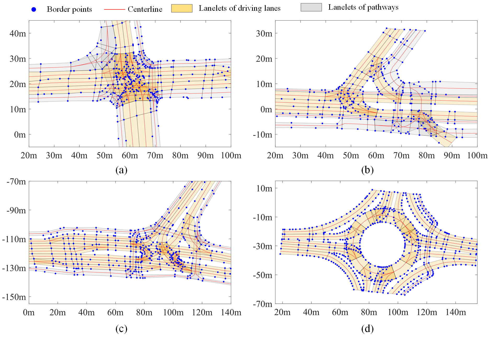

# Lane Centerline Extraction from Surveyed Boundaries

MATLAB reference implementation and synthetic demonstration data for the
maximal-disk lane-centerline extraction method described in:

> C. Yin, M. Cecotti, D. J. Auger, A. Fotouhi, and H. Jiang,
> "Lane Centerline Extraction Based on Surveyed Boundaries: An Efficient
> Approach Using Maximal Disks," *Sensors*, vol. 25, no. 8, article 2571,
> 2025. https://doi.org/10.3390/s25082571

## Scope

This project provides a MATLAB pipeline for lane centreline extraction:

1. Read a Lanelet2 map stored in OSM XML format and extract lanelet boundaries.
2. Align lanelet boundaries and rebuild consecutive lane paths.
3. Calculate lane centrelines using maximal disks.

Users can also start directly from synthetic lane boundaries supplied in MATLAB
format, skipping map parsing and lane reconstruction. The MATLAB parser is a
project-specific implementation, originally developed around inD and rounD
maps; it does not implement the complete Lanelet2 library or all map conventions.
See [parser requirements and limitations](1_extractLanelets/README.md).

## Lanelet2 and demonstration data

[Lanelet2](https://github.com/fzi-forschungszentrum-informatik/Lanelet2) is a map
handling framework for automated driving. In its OSM representation, nodes
store geographic points, ways describe ordered boundaries, and lanelet
relations associate left and right boundaries with attributes. This project
reads those elements into MATLAB structures; installing the C++ Lanelet2 library
is not required for this workflow. Ordinary OSM road maps do not necessarily
contain the lanelet relations required by the parser.

Users can also create their own Lanelet2 maps using JOSM. Lanelet2 styles and
tagging presets are available in
[Lanelet2 / lanelet2_maps / josm](https://github.com/fzi-forschungszentrum-informatik/Lanelet2/tree/master/lanelet2_maps/josm).
Add `lanelets.mapcss` and `lines.mapcss` to JOSM's Map Paint Styles, and add
`laneletpresets.xml` to Tagging Presets. Extract `style_images.zip` to provide
the associated traffic-sign images. For detailed setup steps, see the
[official instructions](https://fzi-forschungszentrum-informatik.github.io/Lanelet2/lanelet2_maps/).

This project supports extracting lanelets from the Lanelet2 maps supplied with
the inD and rounD datasets. Before processing those maps, users need to review
and, where necessary, correct the source maps. Required corrections can include
incorrect left/right boundary assignments within lanelet relations and missing
connections between successive lanelets. The extraction and reconstruction
pipeline assumes these boundary definitions and connectivity relationships are
consistent; it does not automatically repair such source-map errors. Any map
corrections must also comply with the source datasets' terms of use.

Two demonstrations serve different purposes:

- **Jiangsu University demo map:** `0_data/mapData/demo Lanelet2 map.osm`
  illustrates the map-to-centreline pipeline. The associated MAT-files are
  intermediate outputs of parsing and lane reconstruction.
- **Synthetic dummy lanes:** `0_data/LaneletData/laneList_dummy.mat` contains
  generated straight and curved lane boundaries. MATLAB format lets users test
  the centreline method without a geographic map or parser. These are synthetic
  planar coordinates, not surveyed geographic UTM measurements.

See [data contents and provenance](0_data/README.md). The demo map and restored
preprocessing modules are present in the development workspace; their presence
in a clone depends on inclusion in the corresponding Git release.

## Important data notice

The real-world maps used in the paper originated from the
[inD](https://levelxdata.com/ind-dataset/) and
[rounD](https://levelxdata.com/round-dataset/) datasets. 

<p align="center">
  
</p>

<p align="center">
  <em>Lane centerline extraction from synthetic surveyed boundaries using maximal disks.</em>
</p>


Their terms prohibit
redistribution of the datasets or modified versions. Consequently:

- source Lanelet2 maps from inD and rounD are excluded from the public release;
- real-world derived files named `*locn1*` through `*locn5*` are not part of
  the public release;
- private derived data must be reviewed before committing; `.gitignore` is not
  a substitute for checking the release contents;
- users who need the original datasets must request access from the dataset
  providers and comply with their terms independently.

The synthetic dummy lanes contain no inD or rounD map data. The Jiangsu
University demo is a separate map supplied by the project author. Its data
provenance and redistribution permission should be documented before release.

## Requirements

- MATLAB R2020b or later
- Statistics and Machine Learning Toolbox for maximal-disk search and LHS generation
- Mapping Toolbox for WGS84-to-UTM conversion in the Lanelet2 parser

The project was developed for MATLAB R2020b. The current code and the
synthetic workflow were additionally checked with MATLAB R2025b. This does not
establish compatibility of every restored preprocessing function. Recent parser
and reconstruction changes have been statically checked; a fresh full-pipeline
regression run is still needed.

## Choose a workflow based on your input data

The starting point and execution order depend on whether your input is a
Lanelet2 map or an existing MATLAB lane-boundary structure:

| Input data | Execution order |
| --- | --- |
| `0_data/mapData/demo Lanelet2 map.osm` | `1_extractLanelets` → `2_rebuildLanes` → `3_centrelineCalculation/maximalDisks` |
| `0_data/LaneletData/laneList_dummy.mat` | Start directly in `3_centrelineCalculation/maximalDisks`; skip modules 1 and 2 |

The map workflow first parses lanelets and reconstructs consecutive lane
boundaries. The synthetic MAT-file already contains the `laneList` boundary
structure required by the centreline algorithm, so no map preprocessing is
needed. Select the corresponding quick start below.

## Quick start: demo Lanelet2 map

Use this workflow to start from `demo Lanelet2 map.osm`. Run map extraction
first, then lane reconstruction, and finally centreline calculation. Keep the
repository layout intact. In MATLAB, start in the repository root:

```matlab
cd('1_extractLanelets')
main_extractLanelets
cd('../2_rebuildLanes')
main_rebuildLanes
cd('../3_centrelineCalculation/maximalDisks')
main_calculateCentreline_MD
```

The current drivers select the Jiangsu University demo. They use the reference
point `(736190, 3565310)` metres and the parser uses `origin.utm_zone = '50N'`.
The final result is saved as
`0_data/centrelineComparasion/cnlWithMDP_cnlDiscret_5dm_demo.mat`.
Scripts clear the workspace, close figures, and overwrite their configured
outputs. Input files and output directories must exist. Current relative paths
are Windows-oriented, and each script expects its own directory as the working
folder. See the module READMEs before selecting another map.

## Quick start: synthetic boundaries

Use this workflow to calculate centrelines directly from
`0_data/LaneletData/laneList_dummy.mat`. Skip `1_extractLanelets` and
`2_rebuildLanes`. In
`3_centrelineCalculation/maximalDisks/main_calculateCentreline_MD.m`, select:

```matlab
dataName = 'laneList_dummy.mat';       % Input section
utmOrigin.x = 0; utmOrigin.y = 0;       % Origin section
dataName = 'cnlWithMDP_cnlDiscret_5dm_dummy.mat'; % Output section
```

Replace the active demo values in their respective sections, then run the script
from `3_centrelineCalculation/maximalDisks`. Starting in the repository root:

```matlab
cd('3_centrelineCalculation/maximalDisks')
main_calculateCentreline_MD
```

The script loads the configured MAT-file itself; do not rely on manually
loading it into the workspace beforehand, because the script clears the
workspace on startup. No parser or aligned-lanelet MAT-file
is needed: `plotCentreline_MaximalDisk_dummy` plots the lane boundaries directly.
The current driver discretises centrelines at 0.5 m intervals. It processes all
lanes in the selected input; synthetic generation and extraction can take time.

## Input format

The input MAT-file must contain a structure array named `laneList`. Each lane
has this minimum schema:

```text
laneList(i)
├── leftBoundary.Points(j).UTM_x
├── leftBoundary.Points(j).UTM_y
├── rightBoundary.Points(k).UTM_x
└── rightBoundary.Points(k).UTM_y
```

Requirements:

- coordinates are planar metric coordinates;
- points on each boundary are ordered along the direction of travel;
- left and right boundaries describe the same lane and use a consistent
  direction;
- `utmOrigin.x` and `utmOrigin.y` use the same coordinate system as the
  boundary points;
- sparse boundaries are supported, but severely incomplete or incorrectly
  ordered boundaries can produce invalid centerlines.

## Output format

The primary output is the input `laneList` augmented with:

```text
laneList(i).centerline.Points(j).UTM_x
laneList(i).centerline.Points(j).UTM_y
laneList(i).centerline.Points(j).radius
```

`radius` stores the circle radius in metres when available. A value of `0`
is a placeholder for a point whose radius is not stored; it does not mean
that the geometric radius or lane width is zero:

- Points inserted by centreline discretisation have `radius = 0`.
- In the original centre-only ligature-compensation representation, added
  circles also have `radius = 0`. The current compensation implementation
  stores the computed `radius_lgt` for its added circles.

The second output, `circlesConnected`, is the internal connected-circle representation
for the last processed lane and is mainly intended for debugging and
visualisation.

## Repository layout

| Directory | Purpose |
| --- | --- |
| [0_data](0_data/README.md) | Map inputs, intermediate MAT-files and results |
| [1_extractLanelets](1_extractLanelets/README.md) | Lanelet2 XML parsing and coordinate conversion |
| [2_rebuildLanes](2_rebuildLanes/README.md) | Boundary alignment and consecutive lane reconstruction |
| [3_centrelineCalculation](3_centrelineCalculation/README.md) | Maximal-disk centreline extraction |
| [8_buildDummyLanelist](8_buildDummyLanelist/README.md) | Synthetic lane-boundary generation |

`notUsed` directories retain historical or unused functions. They are not part
of the recommended workflow, although the drivers' recursive `addpath` calls
still add these directories to MATLAB's search path.

## Method summary

The implementation searches for maximal disks constrained by sparse left and
right lane-boundary points and segments. Candidate disks are filtered,
connected in boundary order, checked for ligature artifacts, and optionally
discretised into a centerline with a user-defined spacing.

## Limitations

- The method assumes correctly ordered and geometrically consistent lane
  boundaries; it does not repair map topology.
- The centreline algorithm itself does not repair topology. The optional
  preprocessing modules infer connectivity from shared boundary point IDs.
- Results depend on boundary sparsity, measurement quality, lane geometry,
  and the selected discretisation spacing.
- Degenerate or strongly self-intersecting boundaries may require manual
  inspection.
- The code is research software and has not been certified for safety-critical
  planning or control.
- Reproducing the paper's real-world experiments requires separately licensed
  source data that cannot be redistributed here.

## Synthetic data generation

The synthetic `laneList_dummy.mat` can be regenerated using:

- `8_buildDummyLanelist/main_buildDummyLanelist_LHS.m`

This script generates parametrised curved and straight lane boundaries with
different widths, radii, intersection angles, and sampling densities.

## Third-party software

`3_centrelineCalculation/maximalDisks/conicsIntersection1.04` contains
**Conics intersection** by Pierluigi Taddei, version 1.0.4, obtained from
[MATLAB Central File Exchange](https://www.mathworks.com/matlabcentral/fileexchange/28318-conics-intersection).
The bundled copy is unmodified and remains under its original BSD 2-Clause
license. See `THIRD_PARTY_NOTICES.md` and the license file inside that
directory.

## Version and authors

- Public release version: **1.0.0**
- Chenhui Yin
- Marco Cecotti

## Citation

If this repository contributes to your research, cite the associated paper:

```bibtex
@Article{Yin_2025_LaneCenterlineExtractionBasedonSurveyedBoundariesanEfficientApproachUsingMaximalDisks,
  author    = {Yin, Chenhui and Cecotti, Marco and Auger, Daniel J. and Fotouhi, Abbas and Jiang, Haobin},
  journal   = {Sensors},
  title     = {Lane Centerline Extraction Based on Surveyed Boundaries: An Efficient Approach Using Maximal Disks},
  year      = {2025},
  month     = apr,
  number    = {8},
  pages     = {2571},
  volume    = {25},
  issn      = {1424-8220},
  doi       = {10.3390/s25082571},
  publisher = {MDPI AG}
}
```

Machine-readable citation metadata is provided in `CITATION.cff`, and a
standalone BibTeX entry is provided in `CITATION.bib`.

## License

The original project code and synthetic dummy data are released under the MIT
License; see `LICENSE`. The MIT License does not apply to the excluded inD or
rounD data, nor does it replace the license of bundled third-party software.
